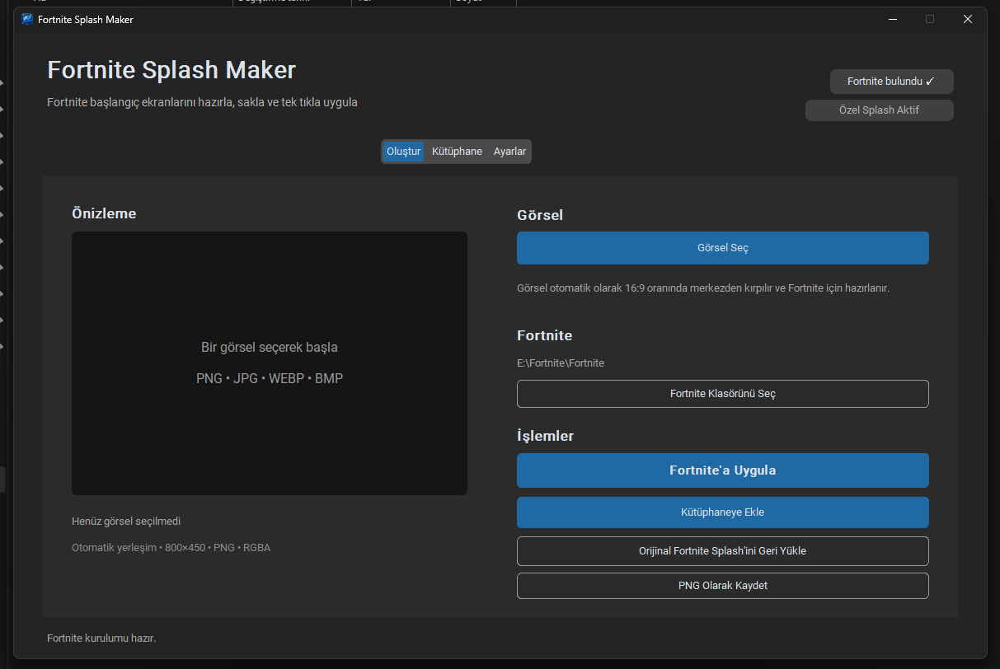

# Fortnite Splash Maker

Fortnite'ın Easy Anti-Cheat başlangıç ekranı (`SplashScreen.png`) için özel görselleri hazırlayan, yerel kütüphanede saklayan ve güvenli şekilde uygulayan Windows masaüstü aracı.

**Sürüm durumu:** Bu kaynak ağacı **v1.1.0 Release Candidate** sürümüdür; kaynak, build ve installer sürüm alanları `1.1.0` olarak güncellenmiştir. **Henüz yayımlanmadı.** GitHub'da yayımlanan son kararlı sürüm **v1.0.0** olarak kalır.

[Kararlı sürümü indir (v1.0.0)](https://github.com/zahidkaya1/FortniteSplashMaker/releases/tag/v1.0.0)



[v1.1.0 değişiklik günlüğü](CHANGELOG.md) · [RC test ve yayın kontrol listesi](docs/RELEASE.md)

## Özellikler

- PNG, JPG/JPEG, WEBP ve BMP görsellerini **800×450, PNG, RGBA** biçimine dönüştürür.
- Epic Games Launcher manifestlerinden Fortnite'ı otomatik bulmayı dener; manuel yol seçimini de destekler.
- Splash dosyasını değiştirmeden önce kurulum başına bir yedek alır; atomik dosya değiştirme yapar.
- İlk yedeği ve **paketle gelen sezon görselini** ayrı ayrı geri yükleme/uygulama seçenekleri sunar.
- Splash kütüphanesinde ekleme, silme, arama ve önizleme bulunur.
- Koyu temalı Oluştur, Kütüphane ve Ayarlar ekranlarına sahiptir.
- Rutin bilgilendirmeleri uygulama içinde gösterir.
- Windows EXE, portable ZIP ve Inno Setup kurulum paketi oluşturulabilir.

**Önemli:** Paketle gelen sezon görseli Fortnite'ın o günkü resmî/güncel görseli olmak zorunda değildir. **Yedeklenen splash**, ilk değişiklikte cihazda bulunan dosyadır; ilk dosya daha önce değiştirilmiş olabilir.

## Klasör yapısı

```text
FortniteSplashMaker/
├── src/
│   └── fortnite_splash_maker/
│       ├── __init__.py
│       ├── __main__.py
│       ├── main.py
│       ├── splash_files.py
│       └── ui/
│           ├── __init__.py
│           ├── components.py
│           ├── dialogs.py
│           └── feedback.py
├── assets/
│   ├── app_icon.ico
│   ├── app_icon.png
│   └── current_season_splash.png
├── docs/
│   ├── screenshots/
│   ├── BUILD.md
│   ├── INSTALLER.md
│   ├── MIGRATION.md
│   └── RELEASE.md
├── installer/
│   └── installer.iss
├── library/
│   └── .gitkeep
├── scripts/
│   ├── run.py
│   ├── run.bat
│   ├── build.ps1
│   ├── build.bat
│   ├── build-installer.ps1
│   ├── build-installer.bat
│   ├── release.ps1
│   └── release.bat
├── tests/
│   ├── test_v11_regressions.py
│   └── test_project_layout.py
├── .gitignore
├── CHANGELOG.md
├── pyproject.toml
├── requirements.txt
└── README.md
```

## Geliştirme ortamında çalıştırma

**Gerekenler:** Windows 10/11, Python 3.10+ (geliştirme ve paketleme için Python 3.12 önerilir).

Proje kökünde:

```powershell
python -m pip install -r requirements.txt
python scripts/run.py
```

Alternatif olarak paketi düzenlenebilir biçimde kurup modül olarak başlatabilirsin:

```powershell
python -m pip install -e .
python -m fortnite_splash_maker
```

> Eski `python main.py` komutu yeni yapıda kullanılmaz; uygulama kaynakları `src/` altına taşındı. **Doğrudan çalıştırma için `python scripts/run.py` kullan.**

## Testler

```powershell
python -m unittest discover -s tests -p "test*.py" -v
python -m compileall -q src scripts/run.py
```

Bu testler GUI davranışlarının belirli kısımlarını ve dosya yönetimini kontrol eder. Gerçek Windows penceresi, EXE ve Setup ayrıca manuel test edilmelidir.

## Windows build ve dağıtım

Normal EXE build:

```powershell
powershell -ExecutionPolicy Bypass -File .\scripts\build.ps1
```

Çıktı: `dist\FortniteSplashMaker\FortniteSplashMaker.exe`

Portable ZIP:

```powershell
powershell -ExecutionPolicy Bypass -File .\scripts\release.ps1
```

Inno Setup kurulum dosyası (Inno Setup 6 kurulu olmalıdır):

```powershell
powershell -ExecutionPolicy Bypass -File .\scripts\build-installer.ps1
```

**Beklenen v1.1.0 RC çıktıları:** `release\FortniteSplashMaker-v1.1.0-win64.zip` ve `release\FortniteSplashMaker-v1.1.0-Setup.exe`. Paketleri oluşturmadan önce `build.ps1` ile EXE'yi yeniden derle; sürüm uyuşmazlığında paketleme betikleri durur. **Bu paketleri henüz GitHub Release'e yükleme** ve mevcut v1.0.0 sürümünün üzerine yazma.

Ayrıntılar: [Build](docs/BUILD.md), [Installer](docs/INSTALLER.md), [Release](docs/RELEASE.md).

## Kaynak klasör yapısına geçiş

Eski kök düzeninden `src/` yapısına geçiş adımları [MIGRATION.md](docs/MIGRATION.md) içinde tarihsel referans olarak tutuluyor. **Mevcut `main` dalında taşıma tamamlandı**; bu adımları yeniden uygulama.

## Veri konumları

- `library/` — uygulamanın yanındaki kullanıcı görselleri.
- `settings.json` — kurulum yolu dahil kullanıcı ayarları, uygulamanın yanındaki dosya.
- `%LOCALAPPDATA%\FortniteSplashMaker\backups` — ilk splash yedeği; uygulamadan/EXE'den bağımsız.
- `assets/` — **kaynak proje** için paketle gelen kaynaklar (build sırasında EXE'ye dahil edilir).

`library/` görselleri, `settings.json`, `build/`, `dist/`, `release/` ve Python önbellekleri Git'e gönderilmez. Kaynak ZIP kullanıcı kütüphanesini ve ayarlarını içermez; var olanlara dokunmaz.

## Yetkiler ve yasal not

Fortnite dosyasına yazma izni yoksa izinlerin kontrol edilmesi veya uygulamanın yönetici olarak açılması gerekebilir. İmzalanmamış Windows uygulamaları bazı bilgisayarlarda SmartScreen uyarısı gösterebilir.

Bu, Epic Games tarafından geliştirilmemiş veya desteklenmemiş bağımsız bir topluluk aracıdır. Fortnite ve ilgili markalar Epic Games'e aittir.
